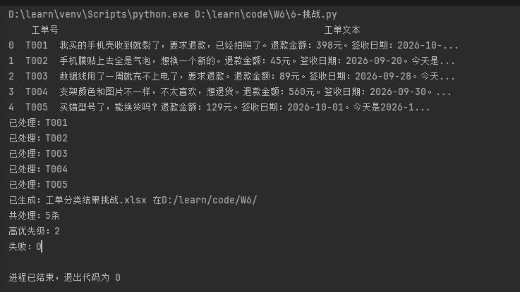
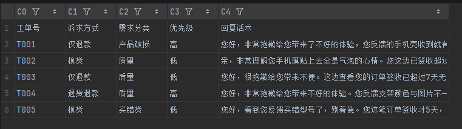

# 售后单自动分类器 v1

> **一句话**：把客户五花八门的售后单，变成**可统计的结构化数据** ——
> 一眼看出「**哪类售后最多、什么原因最多**」，同时自动生成**可导入【客服宝】的回复话术**。
>
> ⚠️ 本仓库数据**全部为演示用假数据**，不含任何真实客户信息。

---

## 功能

1. **自动分类** —— 读一条售后单，判出：
   - **需求分类**：质量 / 物流 / 买错货 / 不想要了 / 产品破损
   - **诉求方式**：仅退款 / 退货退款 / 换货
2. **判优先级** —— 按退款金额分档：**≥300 高 ｜ 200–300 中 ｜ <200 低**
3. **生成回复话术** —— 按「7 天内 / 超 7 天」两套规则生成可直接发给客户的话术，
   **可导入客服宝做团队复用**

> 🎁 **顺带得到一个能力**：售后单被结构化成一张表之后，**可以按任意维度统计** ——
> 比如「哪种售后原因最多」「哪类诉求占比最高」。

## 技术

Python · DeepSeek API · **prompt 工程** · **JSON 结构化输出**（`response_format`）· pandas

## 为什么这么做（设计说明）

- **为什么要结构化输出（JSON）**
  ① 结果**标准化**，能直接写入 Excel；② **方便程序读写** ——
  `result["需求分类"]` 直接取值，不用去切一段自然语言。
- **为什么"能算的"不让模型算**
  ① **省 Token**：偶尔一两条没事，量大了就是成本；② **更快**：程序直接算比模型快得多；
  ③ 模型只要**从程序算好的结果里提取**就行。
  → **「模型负责说人话，代码负责算准数。」**
- **失败了怎么办**
  用 **`try / except`** 接住异常（模型偶发返回空内容、网络抖动），**最多重试 3 次**；
  3 次都失败则跳过该条、计入失败数。

## 怎么运行

1. **装依赖**
   ```
   pip install -r requirements.txt
   ```
2. **配 key**：在项目根目录建一个 `key.env`，写一行：
   ```
   DEEPSEEK_API_KEY=你的key
   ```
   ⚠️ 这个文件**不要传到 GitHub**（写进 `.gitignore`）
3. **跑**
   ```
   python main.py
   ```

**输入**：`工单待处理.xlsx`（两列：工单号 / 工单文本）
**输出**：`工单分类结果.xlsx`（工单号 / 需求分类 / 诉求方式 / 优先级 / 回复话术）

## 项目结构

```
W6/
├── main.py              # 主程序
├── requirements.txt     # 依赖清单
├── .gitignore           # git 黑名单（key.env 不会传）
├── 工单待处理.xlsx       # 输入（假数据）
├── 工单分类结果.xlsx     # 输出（跑完生成）
├── 生成W6工单数据.py     # 造数脚本（可复现）
├── images/              # 截图
│   ├── 01-终端运行.png
│   └── 02-Excel结果.png
└── README.md
```

## 演示

**终端运行：**



**输出的结果表：**



## 已知限制 / 下一步

- v1 只在**命令行**跑，还没有界面（下一步：加 Streamlit 网页版）
- 5 条是**一条条顺序发的**（同步）→ 量大时可以改成**异步并发**来提速
- 还没做「**人工 vs 工具**」的耗时对比数据

## 数据说明

⚠️ 本仓库所有数据均为**自造的演示假数据**（`工单待处理.xlsx` 由 `生成W6工单数据.py` 生成），
**不含任何真实客户信息，也不连接公司真实系统**。

## 📊 效果评测（v1 → v2）

用 21 条手工测试集 + 12 条「刁钻难卷」评测，共 90 个判分格：

| 测试集 | 字段 | v1 | v2（+Few-shot） |
|---|---|---|---|
| 易卷 | 需求分类 | 18/19 = 94.7% | 19/19 = 100% |
| 易卷 | 诉求方式 / 优先级 | 19/19 = 100% | 19/19 = 94.7% |
| 难卷 | 需求分类 | 8/11 = 72.7% | 11/11 = 100% |
| **合并** | **全部** | **86/90 = 95.6%** | **88/90 = 97.8%** |

**改了什么**：加了 5 条 Few-shot 示例，覆盖金额边界（200/300）与「信息不足」判断。

**代价（重要）**：T008 出现回归（v1 判对、v2 变「信息不足」）——
说明 Few-shot 修边界有效，但会让模型**过度保守**。

→ 结论：**改 prompt 必须全量回归测，不能只盯目标样例。**

