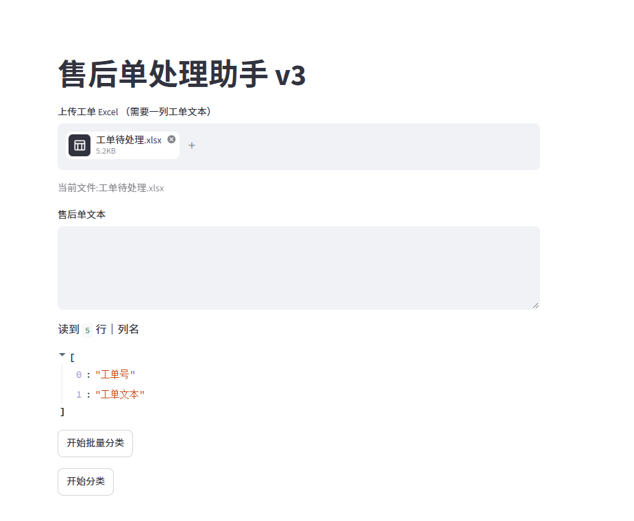
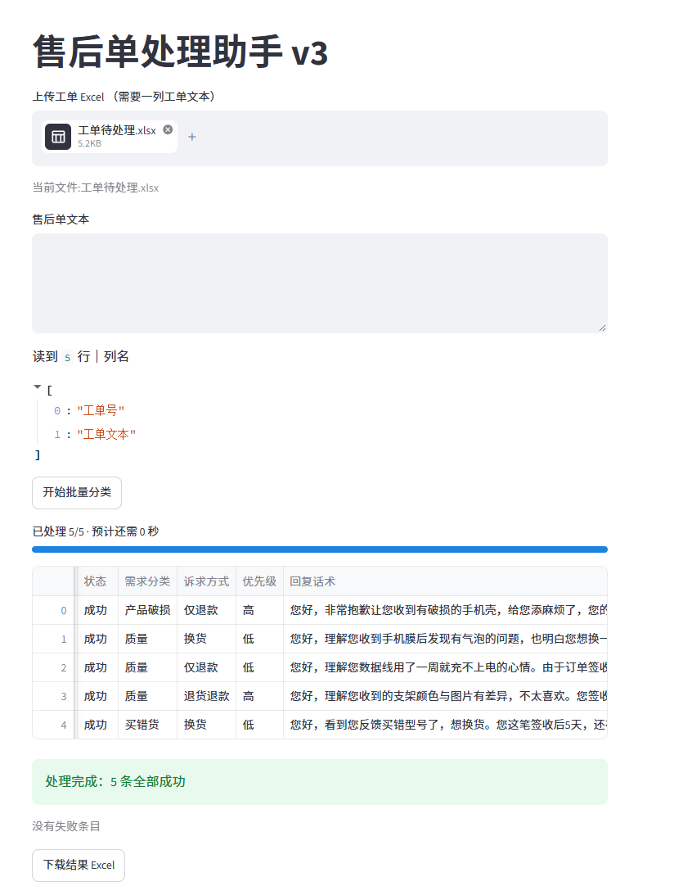
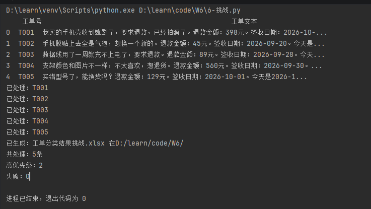
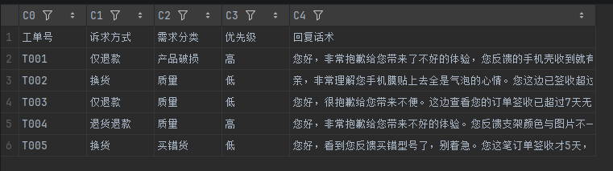

# 售后单自动分类器 v2（命令行 + 网页版）

> **一句话**：把粉丝五花八门的售后单，变成**可统计的结构化数据**，并自动起草**可直接发给客户的话术**。
>
> **我是电商售后客服出身** —— 最开始不熟悉产品规格，既要顾响应率，又要向客户解释清楚，这工具最早就是给我自己写的。

⚠️ 本仓库数据**全部为自造演示假数据**，不含任何真实客户信息。

---

## 它解决谁的麻烦（客户画像）

> **定位**：它是**给新人售后客服的实操训练工具** —— 新人不用先啃 Excel 和 PPT 背产品规格，
> 直接分一个小店从第一单开始练，它 **3–5 秒**给出一条「老手水平」的示范。

**不是卖给有成熟话术库的公司。** 话术库是公司资产，老员工张口就来（实测熟手 **1 秒/条**），工具对他们只有长尾和台账价值。

**真正需要它的是「本来就没有话术库」的人：**

- 一个人的 C 店 / 新店老板 —— 没人带，全凭手感回
- 多平台店主 —— 五个后台，话术各写一遍
- 刚上岗的新人 —— 不知道 7 天时效、金额分档怎么判

对这类人，工具的价值不是快，是**把「老手的判断」变成任何人都能用的东西**。
> 自测过：让一个完全不懂售后的人拿这工具跑，产出的回复「基本上可以」直接发。

---

## 三组实测基线（这是本项目的核心数字）

21 条真实风格的售后单，同一个人、同一批数据：

| 场景 | 每条耗时 | 说明 |
|---|---|---|
| 熟手 + 现成话术库 | **约 1 秒** | 认 4 个字段，套记忆里的模板 |
| 无模板时手写第 1 条 | **34 秒** | 冷启动成本 |
| 手写之后的第 2、3 条 | **3–4 秒** | 改金额、改方案即可 |
| **本工具（含接口等待）** | **3.48 秒** | 21 条全量 **73.08 秒**，技术成功率 **21/21** |

**结论（诚实版）**：**工具不卖速度** —— 熟手比它快约 3.5 倍。
**工具卖的是**：没有话术库的人也能产出「老手水平」的回复；以及每条自动落进 Excel，形成可统计的台账。

**冷启动回本点**：多花的时间 ÷ 每条省下的时间。
（例：从 34 秒降到 3.5 秒，多花的 30 秒在第 1 条就赚回来了；若本来 1 秒，则永远不回本——所以定位是「没有话术库的人」。）

---

## 功能

1. **批量处理** —— 上传 Excel，逐条分类，带进度条 + 剩余时间（ETA）
2. **四个字段** —— 需求分类（质量/物流/买错货/不想要了/产品破损）、诉求方式（仅退款/退货退款/换货）、优先级（≥300 高 ｜ 200–300 中 ｜ <200 低）、回复话术
3. **容错可见** —— 失败条目**写明原因**、可**只重跑失败的**，不重跑已成功的
4. **导出** —— 一键下载结果 Excel，可直接导入客服宝

## 界面

**上传**



**进度条 + ETA + 结果表**



## 怎么运行

```
git clone <本仓库地址>
cd p1-售后单分类器
pip install -r requirements.txt
```

**配 key**（必做）：把 `.env.example` 复制成 `key.env`，填上自己的 DeepSeek key：

```
DEEPSEEK_API_KEY=sk-你的key
```

> `key.env` 已在 `.gitignore` 里，不会被提交。程序按**文件自身所在目录**找它，所以放在仓库根目录即可。

**网页版**
```
streamlit run app.py
```

**命令行版**
```
python main.py
```

输入 `工单待处理.xlsx`（两列：工单号 / 工单文本）；网页版可上传任意同结构文件。

## 技术要点

- **JSON 结构化输出**（`response_format`）→ 结果能直接 `result["需求分类"]` 取值写表，不用切自然语言
- **能算的不让模型算** —— 优先级按金额分档是代码算的：省 token、更快、结果稳定。**模型说人话，代码算准数**
- **重试 + 失败落表** —— 最多 3 次，失败写明原因，可单独重跑；`FORCE_FAIL` 调试开关可注入失败做验证（不花钱）
- **Few-shot 正例教格式，负例教边界** —— 加了一条「反面示例」后，「让客户去找售后客服」这类**说话人视角错误**从 4 条降到抽检 0 条

## 效果评测

33 条测试集（21 条手工测试集 + 12 条「刁钻难卷」），其中 **3 条标准答案本身就是「信息不足」**（没有答案可判，不入分母）→ 实际判分 **30 条 × 3 字段 = 90 格**：

| 测试集 | 字段 | v1 | v2（+Few-shot） |
|---|---|---|---|
| 易卷 | 需求分类 | 18/19 = 94.7% | 19/19 = 100% |
| 易卷 | 诉求方式 / 优先级 | 19/19 = 100% | 18/19 = 94.7% |
| 难卷 | 需求分类 | 8/11 = 72.7% | 11/11 = 100% |
| **合并** | **全部** | **86/90 = 95.6%** | **88/90 = 97.8%** |

**代价**：T008 出现回归（v1 判对，v2 变「信息不足」）→ Few-shot 修边界有效，但会让模型过度保守。
**结论：改 prompt 必须全量回归，不能只盯目标样例。**

**分集看**：易卷 98.2% → 96.5%（**退 1.8**）、难卷 90.9% → 100%（**涨 9.1**）、合并 95.6% → 97.8%（**净 +2.2**）。只敢说「净收益 +2.2」，不敢说「变准了很多」。

**判分口径**：只有「**标准答案本身**是信息不足」的条目才剔出分母（没有答案可判）；**模型自己答「信息不足」计入分母并算错** —— 否则等于拿模型的输出给自己改分。易卷 v2 那 2 格错就是 T008 答了「信息不足」。

## 已知局限（诚实写）

1. **97.8% 只证明「字段判得准」，没测「说话人视角」** —— 那 4 条「让客户去找售后客服」的错误，就是评测指标漏掉的
2. **异议处理弱** —— 客户说「不愿提供任何凭证」时，话术只把要求说得更合理，没有正面接住抗拒
3. **21 条技术成功率 100%，但未逐条人工打标** —— 只有「目测基本可以接受」，没有严格的逐条合格率
4. **分类目录只有 5 类，是我自己定的** —— 超出这 5 类的单子会被硬塞进最接近的那一类（提示词强制从固定列表里选），需要人工复核

## 项目结构

```
p1-售后单分类器/
├── app.py               # 网页版（Streamlit）：上传 → 进度/ETA → 结果表 → 重跑失败 → 导出
├── classifier.py        # 核心：提示词 + 调接口 + 重试（网页版/命令行版共用）
├── main.py              # 命令行版：一次跑完整个 Excel
├── requirements.txt
├── .env.example         # key 的填写格式示例（真 key 放 key.env，不进仓库）
├── .gitignore
├── 工单待处理.xlsx       # 输入（演示假数据 5 条）
├── 工单分类结果.xlsx     # 命令行版输出
├── 生成W6工单数据.py     # 造数脚本（含本机路径，按需修改）
├── images/              # 4 张截图
└── README.md
```

## 命令行版演示





## 迭代记录

- `v1` 命令行版（95.6%）→ `v2` 加 Few-shot（97.8%）
- `v2 → 网页版`：批量上传 / 进度条 / 失败可见可重跑 / 导出
- **搬家时修掉的一个真问题**：`load_dotenv` 原来写死了本机绝对路径（`D:/learn/key.env`），在本机永远看不出毛病，换台机器必崩 → 改成按**文件自身所在目录**找 `key.env`，并加了「读不到就直接报错」的守卫

## 数据说明

本仓库数据均由 `生成W6工单数据.py` 自造，**不含真实客户信息，也不连接任何公司系统**。
